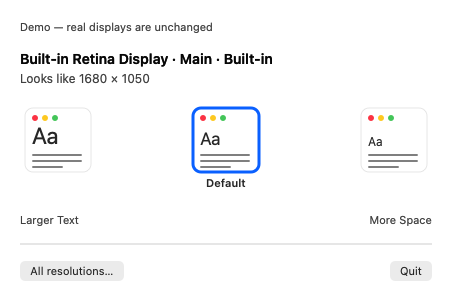

# ResolutionBar

A small native macOS menu bar utility for changing display resolution. Written in Swift and AppKit with no third-party dependencies, network access, accounts, or analytics.

**First-release preview:** macOS 13 or later; Universal app for Apple Silicon and Intel. Read [VERIFICATION.md](VERIFICATION.md) for what was actually tested. Physical resolution switching and Intel hardware behavior require manual verification before a stable public release.



## Use

1. Open ResolutionBar. A display icon appears in the menu bar; there is no Dock icon.
2. Click the icon to open a compact visual picker. Choose among up to five text-size presets, ordered from Larger Text to More Space. Multiple extended displays have separate named sections. Use All resolutions… only when you need the full list.
3. Choose **Keep** within 15 seconds, or choose **Revert**. Timeout, Escape, and closing the confirmation window request the previous resolution again.

The selected preset has a blue outline. Default is shown only when macOS explicitly flags a default mode; it is not inferred from your current selection. The compact picker prefers HiDPI modes, prefers the current refresh rate, with an explicit system default taking priority for its preset, and groups duplicate size/refresh variants. The advanced list marks the current mode with a checkmark. `HiDPI` means Retina-style rendering; `1×` means standard-density rendering, which may look less sharp on a Retina display. Labels show logical resolution and refresh rate when macOS reports it. Hover a mode to see its rendered pixel dimensions. Available modes depend on your Mac, display, connection and macOS version. The app does not create custom resolutions.

Mirrored groups are detected and read-only in this version. This includes a mirror group's primary display. Use extended mode to switch displays independently. The app does not edit arrangement, rotation, or mirroring; macOS may adjust screen positions when their bounds change.

Display lists refresh when the menu opens, after display changes, and on wake. No periodic background polling runs while idle. A short timer runs only during a preview. A disconnected display or an external configuration change cancels confirmation; recovery only touches the original target when its connection and preview mode still match.

## Install a release

Unzip `ResolutionBar.zip`, drag `ResolutionBar.app` to Applications, then open it. Users do not need Xcode or an Apple Developer account.

The local build is **ad-hoc signed and unnotarized**, not signed with an Apple Developer ID. A browser-downloaded build may be blocked by Gatekeeper. If you trust the source, attempt to open it, then use **System Settings → Privacy & Security → Open Anyway** where available. Do not disable Gatekeeper globally. See [Apple's instructions](https://support.apple.com/en-us/102445). Managed Macs can prohibit exceptions.

No Accessibility or Screen Recording permission is requested for the core resolution switcher. To stop it, choose **Quit ResolutionBar** from its menu. To uninstall, quit and delete the app.

### Open at login

The menu suggests **Open at Login** so ResolutionBar can be ready when you sign in. Choose **Not Now** to dismiss the suggestion; the **Open at Login** checkbox remains available in the panel whenever you want to change it. Nothing is registered until you choose to enable it. If macOS reports that approval is needed, choose **Open Login Items…** and allow ResolutionBar in System Settings. Install the app in Applications before enabling the option, so it has a stable location.

## Build from source

Install current Apple Command Line Tools (`xcode-select --install`) or Xcode. Swift 6+ is needed to run the Swift Testing suite. No paid Apple Developer membership or developer sign-in is required for local builds.

```bash
bash scripts/test.sh
bash scripts/build-app.sh
open dist/ResolutionBar.app
```

`build-app.sh` compiles arm64 and x86_64 separately, combines them with `lipo`, builds the app bundle, verifies its local signature, and creates `dist/ResolutionBar.zip` plus its SHA-256 checksum. Build artifacts and caches stay under `.build/local`; set `RESOLUTIONBAR_BUILD_ROOT` to use a different scratch directory. The scripts disable SwiftPM's nested subprocess sandbox for compatibility with restricted build environments. This package has no external dependencies or build plugins.

Use `swift build` for a development binary. With Command Line Tools in a restricted workspace, use the provided scripts so caches and bundled testing-framework search paths are configured correctly.

## Diagnostics and safe demo

From a built app:

```bash
# Read-only: prints connected displays and their modes. Includes display UUIDs.
dist/ResolutionBar.app/Contents/MacOS/ResolutionBar --diagnose

# Simulated displays: dropdown and confirmation work without changing hardware.
dist/ResolutionBar.app/Contents/MacOS/ResolutionBar --demo multiple
# Other fixtures: single, mirrored, none

# Checks menu/picker variants and demo Keep, Revert and close flows; no hardware changes.
dist/ResolutionBar.app/Contents/MacOS/ResolutionBar --smoke-test
```

Demo mode uses a separate in-memory display service. It cannot apply changes to real displays. Quit a running instance before launching another. Diagnostic output can contain display identifiers; review it before attaching it to a public issue.

## Persistence and recovery limits

Preview changes use Core Graphics' application-only scope. Normal Revert restores only the target mode. If the process terminates abruptly, macOS falls back to the session/permanent configuration; that can differ from the exact pre-preview state. A failed rollback is reported.

Keep requests permanent saving. macOS can accept some configurations only for the current login session, so not every mode is guaranteed to survive logout or restart. External-change checks are best effort: the public API has no atomic compare-and-change operation against other apps. The app avoids intentionally overwriting settings changed elsewhere and never invokes the user-wide permanent-configuration restore function.

## Development and publishing

- `Sources/ResolutionCore`: modes, compact scaling presets, menu sections, connection invalidation, preview/rollback policy.
- `Sources/ResolutionBar`: Core Graphics adapter, menu, confirmation and demo.
- `Tests/ResolutionCoreTests`: mode and recovery policy tests with an injected clock/display service; no live hardware mutation.
- `docs/github/ci.yml.example`: ready-to-enable GitHub Actions template for tests on Apple Silicon and Intel runners, plus universal build artifacts. It does not publish releases.

To publish, create a GitHub repository, push this source, and attach the generated ZIP and checksum to a GitHub Release. Review license attribution and bundle identifier before release. MIT attribution currently names ResolutionBar contributors. The workflow template requires no signing secrets. Automatic CI is currently inactive because the publishing login lacks GitHub’s `workflow` scope. To enable it, use a credential permitted to manage workflows, copy `docs/github/ci.yml.example` to `.github/workflows/ci.yml`, and push that file.

For a smoother public installation experience, obtain a Developer ID certificate, sign with hardened runtime, notarize, and staple the notarization ticket before packaging. This optional workflow requires paid Apple Developer Program access; it is not part of this local build script. [Apple's distribution documentation](https://developer.apple.com/developer-id/).

Before a stable release, manually check Keep/Revert/timeout, quit during preview, both CPU families, macOS 13 compatibility, extended and mirrored monitors, identical displays, disconnects, lid-close, wake, full-screen apps, and app-only-to-permanent persistence. Never treat CI compilation as proof of hardware switching.
